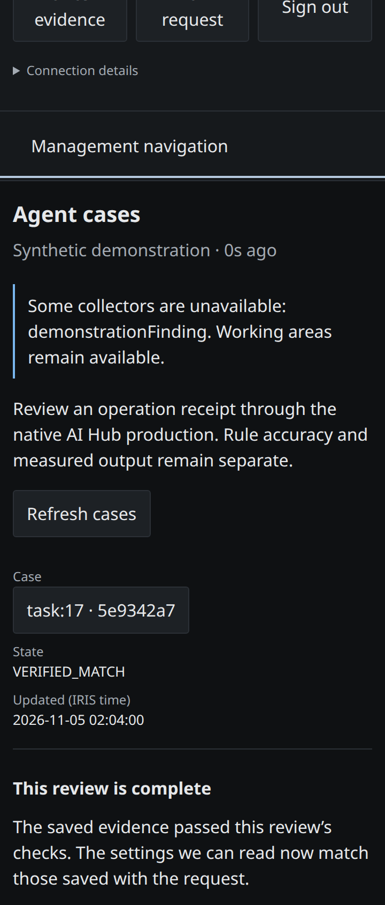
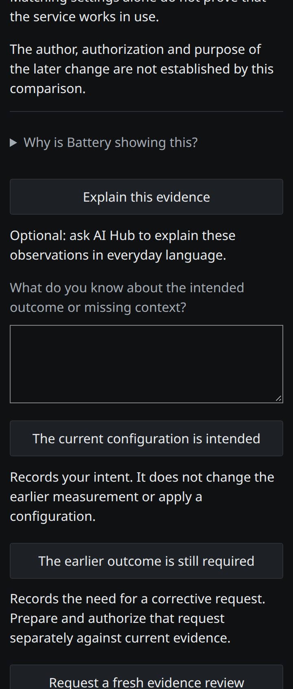
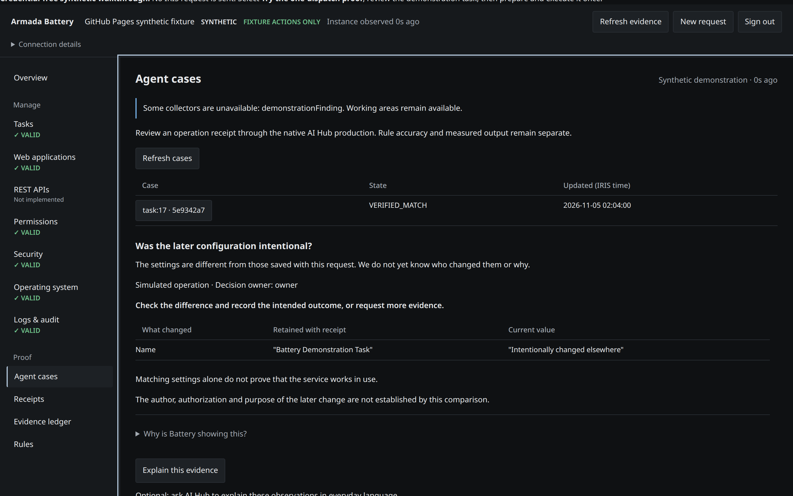

# Decision brief and native explainer — 2026-11-05

## Delivered behavior

Agent Cases now puts an evidence-bound plain-language brief before expandable
technical records. A completed review has no approval buttons. A changed target
shows the retained/current difference and asks whether the later change was
intentional. Technical recovery, missing evidence, ongoing work, superseded
reviews and context decisions have distinct summaries and available actions.

The backend builds the brief from the scoped operation receipt, retained native
result and a current adapter read. Each answer carries an evidence revision;
the server re-reads before accepting it. Operator answers and reasons are durable
ledger events. A repeated answer is idempotent. A request for more evidence starts
one new review revision with the same operation receipt. It does not execute the
business operation again. A corrective intention is recorded and links to target
inspection; the existing prepare/authorize/execute workflow remains necessary.

The optional **Explain this evidence** button calls a third role in the native
IRIS AI Hub operation. It receives a bounded server-built report and returns three
plain-language fields plus evidence references. Scope, state and actions remain
application-owned. The result is cached by operator, case and evidence revision;
late responses cannot be attached to a changed brief. Its full response, usage
and native response ID are retained. An acknowledged failure permits one explicit
retry; an unconfirmed request is not automatically replayed. Native explanation
admissions are bounded to 20 per operator and 100 per service per day.

## Executed evidence

[Machine-readable report](../interop/results/decision-brief-109.json)
contains the installed result, exact source hashes, browser measurements, first
failure and final successful native run.

| Check | Result | What it establishes |
| --- | --- | --- |
| Python suite | 126 passed, including 24 new decision tests | Real engine/ledger and HTTP boundaries; independent assertion/output pairs, stale decisions, duplicate clicks, operator isolation, session expiry, parent revisions, explanation fallback/cache/retry |
| Existing UI handler regressions | 13 passed | Existing preparation, expiry, late response, identity and review-admission behavior |
| Chromium browser assertions | 22 passed over 5 views | 360px, 768px, 1440px and 200% root text; no horizontal overflow, brief visible, technical detail collapsed; mobile choice submission and explainer failure fallback |
| Installed service checks | 16 passed | Real native AI Hub response; scope preserved, cached repeat, stale/invalid decisions rejected, foreign operator hidden, original case result and operation receipts unchanged |
| Native compilation | 6 changed classes compiled | Runtime accepts the changed operation, API, intake, response, record and solver classes |
| Installed application hashes | 5/5 matched | Installed app, bridge, brief builder, JavaScript and CSS equal the qualified source |

[Python log](../interop/results/decision-brief-python.log) ·
[UI regression log](../interop/results/decision-brief-ui.log)

### Failure retained and repaired

The first installed explanation attempt failed: IRIS was reachable but its
interoperability production was **Troubled** after an unclean shutdown. A queued
request produced no response. The structured brief remained available. With no
active case reviews, the documented
[RecoverProduction/StartProduction lifecycle](https://irisdocs.intersystems.com/irisforhealthlatest/csp/docbook/DocBook.UI.Page.cls?KEY=EGDV_adv)
restored the running production. The API now checks production readiness before
admitting an explanation. The failed attempt remains in the report and ledger.
An explicit retry succeeded, followed by qualification of the final plain-language
prompt and brief schema. A 4px overflow in the 200% text check was fixed and retested.

### Screenshots

These are real Chromium renders of the application with explicitly synthetic
brief fixtures, not screenshots of live IRIS inference.







## Limits and next human check

The real model check covers one retained synthetic operation. Contract and citation
validation do not establish semantic correctness across arbitrary cases. No
human-comprehension improvement or decision-quality advantage has been measured.
Similar-case retrieval, arbitrary evidence probes, automatic corrections, broad
lifecycle explanations, and the codex-led visual redesign remain future work.
The current explainer covers the selected final/current evidence summary; the
coverage boundary is included in its input.

**Owner check:** refresh the installed application, open Agent Cases and the
retained case, then read only the new brief. Without opening technical details,
say what happened and whether you need to do anything next. Record confusion
before providing coaching.

## Reproduce

```sh
python -m unittest discover -s tests -v
node --test tests/ui_state.test.js
# Inside the configured, running battery-web container:
python interop/tests/verify-decision-brief.py
```

The installed verification script requires an existing completed synthetic case
and configured native service. It explicitly requests an explanation (or returns
its cached result) and exercises rejection paths; it submits no business action.

## Bounded full case review — 2026-11-06

Agent Cases now offers **Review full case with AI Hub** after the receipt,
investigation trail and current-setting comparison. It is explicit and optional.
The input contains at most 6,144 bytes of selected records, the allowed exits,
first/latest review rounds and recent human responses. Omitted counts are stated;
raw model transcripts and unrelated cases are excluded. The native agent has a
2,200 output-token ceiling. The response rates the recorded choice and its reason
separately, explains what happened and what remains unknown, and cites the exact
source records. It cannot authorize or repeat a business action. A full review
is cached against the exact input digest, so a new human response cannot inherit
an older AI assessment. One failed response permits one explicit retry; an
unconfirmed response is not automatically replayed. Native admission is limited
to 3 attempts per operator and 20 per service per day.

### Adversarial native-model comparison

A seeded draw (`1106`) selected three of four authored synthetic cases. For each,
the agent saw identical operation evidence with three different human exits in
this order: **worst case, perfect control, random incompetence**. The arm labels
were absent from its input. The fourth, lost-reply case was held out until after
prompt refinement. These fixtures test the agent's reading of a person’s choice
and explanation; they are not evidence that the business operation ran.

| Pass | Contract result | Finding |
| --- | ---: | --- |
| First, 850-token output cap | 7/9 | Two truncated JSON responses; the agent often repeated bad reasons without challenging them. |
| Separate choice/reason ratings | 5/9 against the app contract | Four answers failed to cite the human record they graded. |
| Citation instruction, 1,600-token cap | 8/9 | One response still truncated. |
| Shorter prose, 2,200-token cap | 9/9 | One unsupported choice and one vacuous reason were incorrectly endorsed. |
| Allowed-exit packet and final prompt | 9/9 | All three control pairs rated supported; all six flawed reasons rated unsupported or contradicted. Worst-case choices were contradicted, unsupported, or uncertain; the random choices were judged independently from their reasons. |
| Held-out lost-reply case | 3/3 | Bad repeat and vague exit rejected; receipt-based no-repeat control supported. |

The final result is a pass **on these authored cases only**. Earlier misses remain
in the record. Structural validation checks citations, schema and length; it
cannot prove that an agent's assessment is correct. The page labels these ratings
as an AI interpretation and keeps the saved receipt and official case result
visibly separate.

[Final scored run](../interop/results/human-exits-109.json) ·
[held-out run](../interop/results/human-exits-109-holdout.json) ·
[frozen packets](../interop/results/human-exits-109-packets.json) ·
[native output](../interop/results/human-exits-109.log). Earlier logs and scored
reports are retained beside them with `first`, `second`, `third` and `fourth`
suffixes.

### Installed check and remaining limit

The installed build-109 test passed 9/9 checks on an existing synthetic case:
operator sign-in, case/brief access, a native validated full review, no invented
human choice, citations, cached repeat, unchanged case result, and unchanged
operation receipts. The first installed attempt before the input-digest repair
failed its response contract; an explicit retry succeeded. After the repair,
a new packet produced a fresh native answer on its first attempt.
[Installed report](../interop/results/full-review-installed-109.json) and
[earlier report](../interop/results/full-review-installed-109-before-cache.json)
retain both outcomes. The UI browser fixture test has been updated for the new
button and citations, but Playwright was unavailable in this execution environment;
that browser run remains outstanding. Local Python and Node suites passed.

To reproduce the seeded trial, run `python interop/tests/human_exit_eval.py DIR`,
execute `DIR/run.script` through the running IRIS AI Hub production, save output as
`DIR/run.log`, then run the same command with `--score`. Use `--holdout` on a
separate directory to prepare the fourth scenario. The scorer applies the same
response validator used by the application.
