# Connected Battery implementation evidence

2026-11-05. Follow-up to the [whole-system audit](SYSTEM_DESIGN_AUDIT.md).
This report distinguishes injected faults, synthetic business targets, real AI
Hub inference, and a real IRIS configuration operation.

## What now works

```mermaid
flowchart LR
    UI[Operator console] --> Action[Existing preparation and action engine]
    Action --> Ledger[Durable receipt ledger]
    Ledger --> Admission[Immutable native case admission]
    Admission --> Reviewer[Small AI Hub reviewer]
    Reviewer --> Investigator[Larger investigator when needed]
    Investigator --> Tool[Admitted receipt or target read]
    Tool --> Adapter[Authenticated management adapter]
    Adapter --> Review[Bounded follow-up review]
    Review --> Proof[Deterministic scoped proof and final readback]
    Proof --> Cases[Persistent case result and operator history]
```

1. A receipt can be submitted from the console to the native IRIS production.
   Stable request keys retain the same immutable context and case ID. Repeated
   business execution keys return the original receipt.
2. The investigator's admitted tool selects an actual ledger or target read.
   The model cannot supply an arbitrary URL, invent browser evidence, or issue
   a business mutation through these tools.
3. A malformed reviewer response may receive one bounded contract repair.
   Rejected raw answers, validation reasons and usage remain recorded. Provider
   transport errors do not cause an inference retry.
4. Native cases and their results have persistent volumes. A container was
   replaced and its completed case, exact result JSON and response ID survived.
5. Browser collectors resolve independently with deadlines. The phone layout
   has larger controls and readable form text. Case detail exposes the two
   judgments, raw reviews and actual tool observations.

## Real configuration qualification

The test used the existing management engine, its SysAdmin HTTP adapter, the
native API, native Interoperability queues, AI Hub model calls, and authenticated
evidence callbacks. It created a uniquely named temporary REST application in
the disposable EAP109 installation. The client sent the execution request once
and closed the connection before reading the response.

The test recovered `VERIFIED_SUCCESS` from the ledger, reused the execution key
and received the same receipt, observed one configuration with that unique name,
then submitted the receipt for native review. The case reached `VERIFIED_MATCH`
with assertion YES and output PASS after `CHECK_EFFECT_RECEIPT` and a final
configuration readback. The application and temporary test identity were removed.
This is configuration verification; the test does not establish the functional
behavior of the configured REST service or independently count every HTTP PUT.

The native review took **26.152 seconds** in this recorded run. Its three real
model calls used **3,081 prompt tokens and 2,786 completion tokens**. These are
provider usage counters, not an invoice. The initial reviewer mislabeled absent
evidence as FAIL, and the investigator hypothesized failure. The tool retrieved
an existing successful receipt; follow-up review and deterministic proof produced
the supported result. This is why raw model statements remain separate from proof.

Two concrete adapter defects were found and fixed during qualification:

- The write adapter translated `NameSpace` to `Namespace`; the installed SysAdmin
  v1 endpoint requires `NameSpace` for creation.
- The desired configuration contained `Type`, which this endpoint does not
  return, and its authentication mask came back as an integer. The plan now
  uses the endpoint's fields and normalizes that specific numeric mask.

The schema was checked against the installed vendor endpoint; proprietary vendor
source is not redistributed. Regression tests preserve the required write field
and test the actual numeric readback shape. Failed attempts remained
`OUTCOME_UNKNOWN`; the test never converted those records into later successes.
Receipts now retain safe HTTP status codes without disclosing upstream bodies.

## Executed checks

| Check | Scope | Result |
| --- | --- | --- |
| Native proof matrix | Typed scope, time, count and result checks | 149/149 passed |
| Native solver faults | Repair, tampering, missing/changed evidence and transport errors | 31/31 passed |
| Native agent faults | Service/process/operation orchestration with injected provider faults | 26/26 passed |
| Real-model repeat | Eight synthetic receipt scenarios, three repetitions | 24/24 expected dispositions |
| Python suite | Engine, API, admission scope, restart/replay, adapter contracts | 75 passed |
| JavaScript lifecycle suite | Deadlines, stale response isolation, UI state | 8 passed |
| Browser 360px and 1440px | Actual HTML/CSS/JS with explicitly synthetic API fixture | No horizontal overflow; case view inspected |
| Hung browser collector | `/api/assurance` never settles | Other panels render; timeout is visible; refresh re-enabled |
| Connected synthetic operation | Real HTTP, native queues and AI Hub; synthetic task target | VERIFIED_MATCH; action and case keys reused correctly |
| Container replacement | Real native storage and trace | Same case JSON and response ID 30 after replacement |
| Real IRIS web application | Real configuration, receipt recovery, AI Hub, cleanup | All five runner checks passed |

The real-model repeat made 46 calls: 35,500 prompt tokens and 41,208 completion
tokens. It had zero unexpected holds and zero incorrect verified dispositions.
One actual reviewer response cited invalid fact IDs on `solver4-live-recovered-3`;
the new repair path obtained a valid replacement and completed the case. Both
responses remain recorded. All 28 raw reviewer assertion/output pairs matched
the fixed oracle, including the response rejected for its citations. The
combined compile/fault/repeat/proof command took 262.257 seconds. This smaller
run does not replace the historical 240-case denominator.

Native final gate and source-hash manifest are recorded in
[`implementation-109.json`](../interop/results/implementation-109.json).
[First connected synthetic trace](../interop/results/connected-synthetic-109.json) ·
[Final rebuilt application trace](../interop/results/connected-final-109.json) ·
[Real IRIS trace](../interop/results/connected-iris-109.json).

The real configuration and persistence traces preceded the final case-list
payload and probe-display refinements. The rebuilt runtime was recompiled and
qualified by the native matrix plus a fresh connected application run; the final
trace retains the investigator’s proposed and executed tool correctly.

Browser evidence uses a synthetic API fixture, not a live authenticated browser
journey through IRIS. The integration runner exercises the real HTTP APIs
separately. Native fault tests inject model/transport failures; real provider
calls are reported separately. The old 240-case run is retained unchanged.

## Audit disposition and remaining work

| Finding | Current disposition |
| --- | --- |
| D01 bounded repair | Injected checks passed; one naturally occurring invalid-citation response recovered during the real-model repeat |
| D02 complementary agents | Investigator-selected evidence reads connected; no autonomous business repair |
| D03 intake and operator cases | Implemented for this single-operator installation |
| D04 evidence acquisition | Durable receipts and configured target reads connected; other workflow adapters remain unqualified |
| D05 container lifetime | Named native and ledger volumes; actual replacement test passed |
| D06 hung collector | Reproduced, repaired and browser-checked |
| D07 duplicate admission | Durable key/context and native claim; integration replay checked |
| D08 resource control | Bounded calls and container limits; shared admission/queue budgets still open |
| D09 shared access/retention | Separate private credentials and operator scoping; multi-tenant ACL and retention policy still open |
| D10 mobile usability | Phone controls and case view improved; broader assistive-technology review remains |
| D11 claims and presentation | Synthetic, live, historical and unqualified behavior explicitly labeled |
| D12 qualification breadth | Real adapter and restart seam added; unseen semantics, ablation and sustained load remain open |

A crashed native run may remain RUNNING; automated abandoned-run detection is
not implemented. Queue admission and durable records span a seam that can yield
ADMISSION_UNCERTAIN. An operator must inspect that trace before creating a
revision. Database/code volume upgrades require explicit compilation and a
matched backup. Vendor-account hardening is outside the adapter provisioning
script. Qualification used localhost-bound services on one operator’s host.
This is a qualified local preview, not a completed shared service.

The normal shared-workspace SSH test route was attempted and failed resolving
`ct200`. The isolated public checkout's Python/Node suites and the Windows EAP
Docker qualifications did execute. No broad fleet deployment is claimed.

## Subsequent service-controls work

The results and open boundaries above describe the original integration run.
[SERVICE_EVIDENCE](SERVICE_EVIDENCE.md) records the later lease recovery, admission
budget and shared-identity qualification; it does not alter these historical results.
