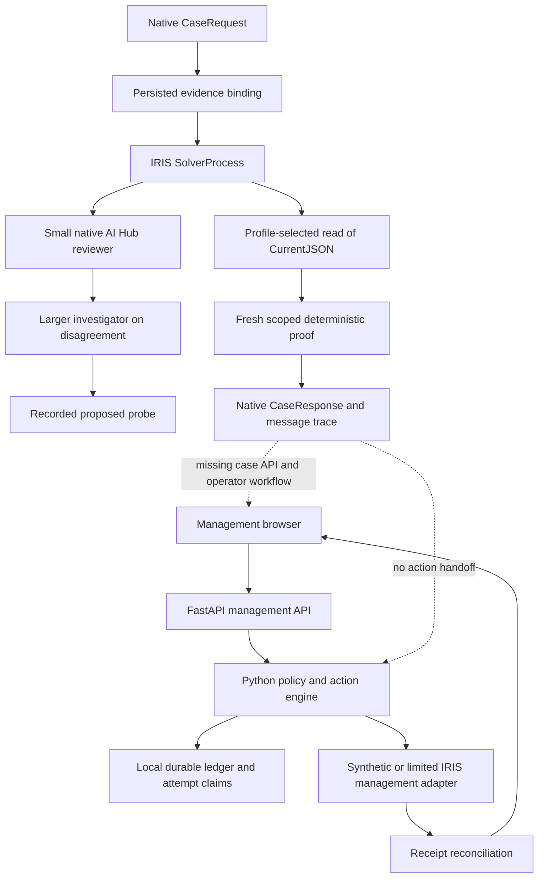

# Battery whole-system design audit

Date: 2026-11-04. Scope: Armada Battery's management application, native IRIS AI
Hub production, evidence contracts, agent roles, execution, persistence,
deployment, operator experience, and qualification. This is an audit and a
proposed integration plan; it does not claim the proposed changes are built.

Native baseline: public commit `a294987f6a39091a82e7e5eb88c272e3d2eab364`.
Management source was inspected in both the shared checkout at
`3348a06ca8f96fce421233045198dd140e626e9a` and that public baseline. The public
branch additionally contains the synthetic demonstration-finding card and
endpoint. Its browser and focused Python checks were repeated after identifying
this difference. Source hashes and separate results are in the audit evidence;
publication of this report does not replace public runtime files with older
shared-checkout copies.

## Verdict

The core distinction is sound: **whether a rule's assertion is supported** and
**whether the observed output satisfies acceptance** are separate questions.
Battery also has useful execution machinery: durable attempt records,
idempotency, fresh evidence checks, and reconciliation after an uncertain send.

The product currently has two implementations with different entry points:

1. A Python management application with action preparation, execution, and
   receipts, exercised through synthetic adapters and limited IRIS interfaces.
2. A native AI Hub receipt-review production with real model calls, strict
   response validation, and a deterministic gate over persisted synthetic
   observations. It has no business mutation or integrated operator case view.

They do not yet form the single end-to-end agentic product described in the
architecture. Repeating the receipt tests reveals reliability problems inside
the second implementation; it cannot establish the missing integration.

The completed frozen run reached **230/240 expected dispositions (95.83%)**.
Ten cases stopped unexpectedly for review because of invalid evidence citations.
There were **zero incorrect verified dispositions** in this fixed corpus. Raw
reviewer assertion judgments matched 258/270 and output judgments 254/270;
correct final containment and raw model accuracy are different measurements.
The run took 2,354.815 seconds, with 438 model calls. Median case latency was
10.005 seconds and p95 was 16.912 seconds. These results are reproducible evidence
of the tested profile's limits, not a claim of universal correctness.

## Actual system map

The native `VERIFIED_MATCH` state means a bounded measurement matched. It does
not mean a repair happened. The management engine's `VERIFIED_SUCCESS` has a
different, action-specific meaning. Neither label should silently stand in for
the other.

## Findings and priorities

P1 means necessary for the next reliable integrated demonstration. P2 means
necessary before offering a sustained shared service, or important usability
work. "Observed" means executed evidence; "source" means inspected code;
"gap" identifies functionality that is not implemented, rather than a failed
implementation of an existing promise.

### D01 — P1: model format failures can stop an otherwise decidable case

**Observed.** The longer frozen run produced valid JSON with semantically
correct answers but invalid `evidence_ids`, including `receipt-review` instead
of an actual fact ID. `CaseProcess.ValidReview` correctly rejects it.
`SolverProcess` then exits `HELD_FOR_REVIEW` before completing the evidence
path. A recovered-receipt case also stopped at its second review.

**Change:** retain the rejected answer, issue one bounded contract-repair
request carrying the allowed fact IDs and validation reason, then escalate or
hold explicitly. Do not replace a bad citation silently or weaken the validator.
Display the independently computed proof separately from review completeness.

**Acceptance:** injected invalid citations, extra keys, truncated answers, and
timeouts yield a visible reason; exactly one permitted repair; failed repair
stops; repaired answers still pass the original validator. Repeat the frozen
corpus on the new revision, plus unseen contract variants. Preserve this run.

Sources: [CaseProcess](../interop/Battery/Interop/CaseProcess.cls),
[SolverProcess](../interop/Battery/Interop/SolverProcess.cls),
[repeatability evidence](../interop/results/solver-repeat-109.json).

### D02 — P1: the two agent layers do not yet deliver complementary solving

**Source/gap.** The investigator may recommend seven probe types. The receipt
solver chooses only a receipt read or fresh readback using its own predicates;
both currently retrieve the same persisted `CurrentJSON`. The larger model's
proposal is recorded but does not select the executed investigation.

The deterministic receipt proof already knows how to classify this narrow
profile. Current results demonstrate native model review and containment of
model errors; they do not demonstrate additional cases solved by the larger
agent. A cheap simple path is also not yet cheap: every valid bound case calls
the reviewer, and negative/unknown findings usually call the larger model.

**Change:** implement a small tool registry with genuinely different evidence
sources, preconditions, input schemas, scope, cost, and observable postconditions.
Let the investigator choose among applicable read-only tools; the orchestrator
validates and executes the choice. Record proposed, admitted, executed, and
rejected probes separately. Require new evidence or stop. Initially implement
receipt lookup and target-version readback, not seven nominal tools.

**Acceptance:** compare deterministic-only, small-reviewer, and two-layer
policies on the same held-out cases. Measure extra correct resolutions,
incorrect dispositions, unnecessary escalations, latency, and usage. Include
cases requiring evidence that was absent from the initial snapshot. Keep the
two binary questions in every comparison.

Sources: [AgentOperation](../interop/Battery/Interop/AgentOperation.cls),
[EvidenceOperation](../interop/Battery/Interop/EvidenceOperation.cls), SolverProcess.

### D03 — P1: no common intake, case API, or operator queue

**Source/gap.** The native service accepts programmatic requests, but cases
require an adapter-owned binding seeded separately. The management API has no
native case submission/status/resume endpoints. Its browser cannot inspect the
two reviewers' findings or resolve a held native case.

**Change:** one versioned case API and one case detail view. A trusted ingestion
adapter establishes the evidence binding; ordinary submitters cannot supply
their own authoritative observations. Expose pending, running, needs evidence,
needs review, measured match/mismatch, and operational attempt state explicitly.
Every hold needs a reason, required evidence, and a permitted next action.

**Acceptance:** a new user submits a documented example without editing test
classes; watches the real native trace; supplies authorized new evidence;
resumes the same case revision; sees the final disposition and model usage.

Sources: [IntakeService](../interop/Battery/Interop/IntakeService.cls),
[EvidenceBinding](../interop/Battery/Interop/EvidenceBinding.cls), [app.py](../app.py).

### D04 — P1: evidence validation is stronger than evidence acquisition

**Source/gap.** Scope, count, types, freshness, and independent acceptance are
checked strictly. The adapter itself reads synthetic persisted values; it does
not query the external system that supposedly produced the effect. A nonempty
`source` label is not source authentication. Binding equality prevents changed
request bytes from being substituted, but does not establish who may write the
binding table. The documented boundary explicitly is not a new database ACL.

**Change:** authenticate an adapter identity, constrain its partner/target
scope, retain native source receipt IDs, and version each observation. Record
completeness: observing no receipt is different from an incomplete search.
Normalize external timestamps explicitly; current `$HOROLOG` seconds are not
Unix timestamps. Keep unknown, observed zero, and observed mismatch distinct.

**Acceptance:** a controlled external fixture produces and retrieves a real
receipt through the adapter; wrong tenant, incomplete pages, forged source,
clock disagreement, duplicate receipts, and out-of-order revisions all have
defined outcomes. Merely storing another JSON fixture is insufficient.

Sources: EvidenceOperation, [OutcomeProof](../interop/Battery/Interop/OutcomeProof.cls),
[receipt contract](../interop/RECEIPT_SOLVER.md).

### D05 — P1: native data lifetime is tied to its container

**Source and runtime inspection.** `compose.interop.yaml` declares resource limits and localhost ports
but no persistent volume or durable data directory. Native databases and traces
live in the container's writable filesystem. Removing/replacing that container
would discard them. Post-run inspection returned `MOUNTS=[]` and image
`DECLARED_VOLUMES=null`, confirming that there is no implicit image volume here.
No destructive test was performed against the running demo.

**Change:** configure the vendor-supported durable data arrangement, separate
build output from runtime data, provide backup/restore and schema migration
instructions, and pin the qualified image digest. Add readiness checks for the
namespace and production, not just a listening port.

**Acceptance:** on a disposable installation, create a case, replace the
container, restore the service, and retrieve the same case and native trace.
Upgrade failure must leave a documented recovery path.

Sources: [compose.interop.yaml](../compose.interop.yaml),
[merge.cpf](../interop/merge.cpf), [Dockerfile.interop](../Dockerfile.interop).

### D06 — P1: one hung browser collector stalls the entire overview

**Observed.** With the existing labeled demo API and only `/api/assurance`
changed to a never-settling promise, real Chromium kept the overview empty,
Refresh disabled, and no error displayed. `load()` waits for all collectors
(six in the shared checkout, seven in the public baseline);
`api()` has no request deadline. Other fixture endpoints returned normally.

**Change:** bounded read deadlines and independently rendered collector states;
release controls in `finally`; preserve partial results with source/freshness.
A mutation timeout must enter receipt reconciliation, never automatic resend.

**Acceptance:** one hung collector leaves five areas usable and shows its own
timeout; refresh works again; delayed old results cannot overwrite a newer
refresh. A lost execution response retains the same idempotency key.

Sources: [app.js](../static/app.js), [browser evidence](audit/design-audit.json).

### D07 — P2: native repeat requests have no application-level durable claim

**Source/gap.** The native solver has no explicit case revision claim, replay
result lookup, or resumable application step journal. IRIS message persistence
is useful, but is not proof of these application semantics. Repeated CaseIds
can spend model calls again. Native multi-request contention has not been
qualified. The Python action engine separately has tested durable claims.

**Change:** key work by tenant, case, revision, policy version, and operation;
persist claimed/completed steps and their evidence hashes. Reuse a still-valid
result or join in-flight work; resume incomplete reads without dispatching a
business effect again. Reconcile any uncertain mutation before considering a
new attempt. Reuse the existing action engine through an explicit interface.

**Acceptance:** simultaneous identical submissions, changed payload under the
same key, crash between steps, process restart, and repeated operator clicks
produce one logical workflow and inspectable recovery.

### D08 — P2: bounded calls do not yet provide service-level resource control

**Source/risk.** Agent calls have output/iteration limits and request timeouts;
review and probe rounds are bounded. All configured production pools have size
one. There is no overall case deadline, per-partner budget, admission limit,
cancellation contract, or provider circuit breaker. Queue pressure and outage
recovery were not load-tested. Do not raise concurrency before measuring it.

**Change:** separate queue wait from execution time; attach deadline and
remaining token/call budgets to each case; stop admitting new work during a
provider outage; expose retry-after and operator cancellation. Verify whether
underlying inference stops after an IRIS request timeout before claiming it does.

**Acceptance:** bounded burst and provider outage tests show queue depth,
resource use, rejected/deferred requests, cancellation behavior, and eventual
recovery. Costs include failed and cancelled calls where usage is available.

Sources: [Production](../interop/Battery/Interop/Production.cls), AgentOperation,
CaseProcess, SolverProcess.

### D09 — P2: shared-service access and retention need an explicit design

**Source/gap.** The management product uses a single installation access key
and configured operator identity. Without a key, it permits the documented
local mode. The native production does not add per-partner operator access.
Original case inputs and model outputs remain in native message storage even
when only reduced facts are sent to the model. The local hash-chained ledger
is not an independently controlled append-only audit service.

**Change:** keep the local deployment explicit; before shared hosting, bind
case access to authenticated principals and tenant scope, redact at ingestion,
define trace retention/deletion and backup policy, and restrict binding writes
to adapters. Record administrative changes to policy and evidence. Claims of
tamper resistance must identify the independent trust boundary.

**Acceptance:** cross-partner read/write denial, redaction canaries in every
store/export, role-limited review, retention expiry, and scoped backup recovery.

Sources: app.py, [ledger.py](../battery/ledger.py), EvidenceBinding, native traces.

### D10 — P2: mobile layout fits, but operation targets and hierarchy need work

**Observed.** Real Chromium at 1440 and 360 CSS pixels had no horizontal
overflow in the overview; the 360px request form also fit. Visible buttons and
selects were 39px tall with 14px text; connection metadata was 12px. The page
uses a consistent restrained visual system, visible focus, and a linear action
lifecycle. The phone request view is long, and the main task context competes
with repeated preparation/authorization messaging.

**Change:** use at least 44px primary touch targets and 16px phone form text as
the product's design targets; condense repeated state messaging; keep the
current decision and next action easy to find. Extend the same view to native
cases rather than introducing an unrelated agent dashboard. These measurements
are not a full accessibility certification or a real-device usability study.

**Acceptance:** phone/desktop review, keyboard-only completion, 200% text,
screen reader state announcements, long evidence IDs, pending/failed requests,
and virtual keyboard checks. Check zoom and drawer behavior on an actual phone.

Sources: [HTML](../static/index.html), [CSS](../static/app.css), browser evidence.

All eleven navigation handlers rendered their respective pages without an error
in the phone fixture. A 200% text-size smoke check retained a 360px document
width; it was not a complete zoom/accessibility qualification. The attempted
full browser execution did not complete: Courier's HTML-string surface was an
insecure `about:` context without `crypto.randomUUID`, and preparation visibly
reported that limitation. This is recorded as a harness limitation, not as a
failure of the application's documented localhost/HTTPS deployment.

### D11 — P1 for presentation: qualify the tested capability precisely

**Source.** The old product spec describes management operations; the newer
architecture includes future agent execution and tooling. Its introductory
runtime qualification disclaimer predates real native runs. The old native
`Demo` freeform inputs do not supply the new evidence bindings; current README
warns about this, but a new user's shortest route still runs a test suite.

**Change:** one current capability matrix distinguishing native live calls,
synthetic evidence, real adapter reads, operator UI, and future work. Publish
one default example and exact expected outcomes. Keep historical reports,
including failures, linked by source revision. A longer run supersedes any
suggestion that the earlier 24/24 sample establishes flawless operation.

**Acceptance:** fresh-checkout walkthrough with no undocumented test-class
editing; every public statement maps to a named executed receipt or a clearly
marked design item.

### D12 — P2: qualification needs variety and independent oracles

**Observed/design.** Repetition measures stability of eight fixed scenarios
already used during development. It does not test unseen workflow semantics,
real adapter authenticity, load, or business effects. Raw model answers and
final deterministic dispositions must remain separate scores. A held case can
be correctly contained yet still fail the intended completion path.

**Change:** add held-out, generated contract variants; partner/schema/version
changes; ambiguous completeness; clock boundaries; long/redacted inputs;
contradictory rules; and crash/concurrency tests at actual integration seams.
Derive expected outcomes independently of the production evaluator. Persist
seed, case, expected result, raw answer, final state, trace, and source hash.

**Acceptance:** report per-scenario errors and denominator, unexpected holds,
incorrect verified outcomes, recovery success, latency, usage, and ablation
results. Zero observed errors on a finite corpus is not a universal guarantee.

## Proposed common contracts

These are design contracts, not additional implemented classes.

| Record | Required purpose |
| --- | --- |
| Case | Identity, tenant, revision, requested outcome, source references, current state and owner |
| RuleEvaluation | Rule/version, applicability, assertion, independent acceptance, defeated/conflicting rules |
| EvidenceSnapshot | Source identity, scope, revision, capture/expiry, completeness, normalized values and hash |
| Review | Assertion YES/NO with supported/false/unproven reason, output PASS/FAIL/UNKNOWN, citations and raw response |
| ProbePlan / ProbeResult | Allowed tool, inputs, budget, admission decision, actual observations and failure reason |
| MeasurementDecision | Deterministic verdict for a specific immutable snapshot, separate review status |
| ActionPermit | Operator/policy authority, exact target/action/evidence revision, expiry and single-use scope |
| Attempt / Receipt | Durable dispatch claim, idempotency key, transport state, correlated readback and outcome |

The immutable case revision is the join between the two existing systems.
Agent text never becomes a command. A probe obtains evidence. A measurement
decision assesses it. An action permit authorizes a particular change. A receipt
establishes what happened. Each boundary should have its own visible failure.

### Operator experience

Use one case page with four readable sections: **request**, **what we know**,
**why the rule did or did not fit**, and **next step / outcome**. Put the two
primary findings beside one another. Keep raw model answers, tool arguments,
native trace IDs, and usage in expandable evidence details. A held case names
the evidence or person needed to move forward. Resume appends a new revision;
it never erases the earlier failure. On mobile, keep the current state and next
permitted action visible while allowing the evidence to scroll normally.

An investigator's hypothesis should read as a hypothesis. A suggested repair
should show its intended effect and verification method before it is admitted.
The existing management workflow can supply the prepare/authorize/execute/verify
interaction once the native case is connected to it.

## Build order

1. Preserve the frozen repeatability result. Repair the review-contract failure
   path in a new revision; prove bounded recovery without accepting bad evidence.
2. Persist native data and introduce the case API/operator view. Fix the browser
   collector stall while connecting the view to real native statuses.
3. Add one real receipt adapter and one genuinely different investigation tool.
   Run a withheld case where the larger agent chooses useful new evidence.
4. Connect an eligible resolution to the existing action engine's permit,
   attempt, and receipt interface. Demonstrate one bounded reversible operation
   on a disposable target, including a lost response and restart.
5. Qualify access, budgets, concurrency, retention, and mobile operation before
   shared hosting. Expand rule coverage only after this complete path works.

This order turns the existing pieces into a usable system while making the
larger investigator's contribution measurable.

## Evidence and limits

- [Repeatability report](../interop/results/solver-repeat-109.json): frozen
  30 × 8 native cases, real model calls, per-case traces, failures and usage.
- [Prior receipt report](../interop/results/solver-109.json): historical
  149 proof checks, 27 workflow faults, and the earlier 24-case live run.
- [Design audit evidence](audit/design-audit.json): source hashes, executed
  tests, Chromium measurements, and the injected hanging collector.
- Public-baseline fixture captures: [desktop](audit/desktop.png),
  [phone](audit/mobile.png), and [stalled collector](audit/stalled-assurance.png).
- The public baseline passed twelve Python execution tests and eight API tests;
  the shared checkout passed twelve execution tests and six API tests. Four
  Node UI state tests also passed in each checkout. These use disposable/synthetic
  state and do not qualify native
  action execution. The two checkout counts are not independent scenario counts.
- Normal DevLathe checks for API and runtime files were cached green; separate
  direct executions supplied the fresh counts above. The `ct200` SSH alias did
  not resolve in this environment; no deployment was attempted.
- Browser captures use the actual application HTML/CSS/JS and existing labeled
  synthetic demo API, with its URL base adjusted for rendering. They do not
  establish live IRIS browser integration. The hung endpoint is intentional.
- Container replacement, native load, real-device touch, screen readers,
  external adapters, and new agent-driven actions were not executed in this audit.

The audit itself changes documentation and evidence only. Runtime fixes and
the proposed integration remain subsequent work.
