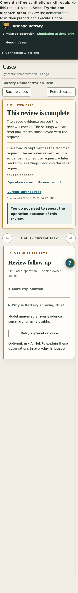
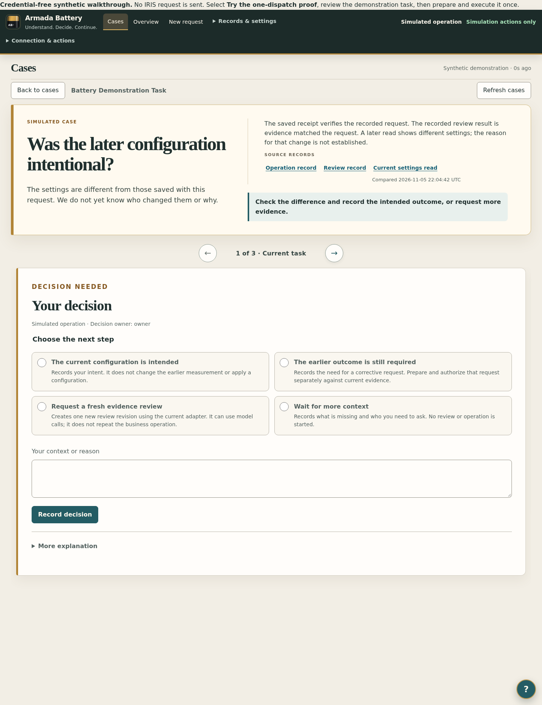
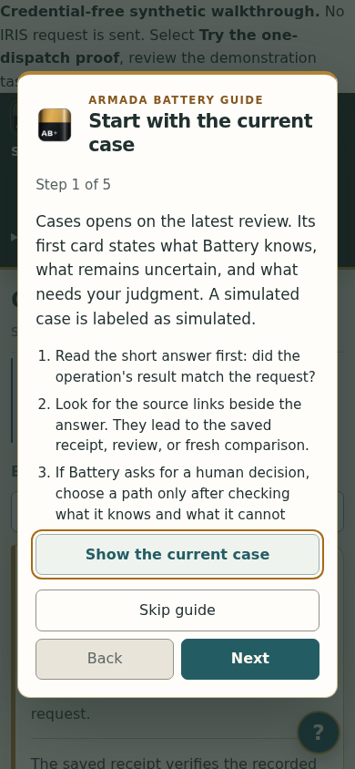

# Battery UX refinement — delivery and evidence

Updated: 2026-11-07. The Battery logo now anchors a warm paper-and-graphite
visual system, with restrained brass accents, teal actions, readable type and
labelled semantic states. The receipt and a plain-language account share the case view; supporting
history, optional explanation and technical records expand beneath each section.

## Delivered

- Cases is the first-visit home and opens the latest returned review directly.
  The explicit `#cases/all` route keeps search and browsing available. Explicit case/receipt links survive sign-in and
  browser reload. A later visit without a route remembers the last destination.
- List search and filters, stable loaded ordering, scope labels and plain statuses.
  The list is limited to up to 50 recent authorized reviews. The decision filter
  explicitly covers inspected cases; it does not claim to inspect every current
  target or count all outstanding decisions.
- Case/receipt navigation preserves the selected case, draft reason, selected
  option, expanded disclosures, scroll and focus within the signed-in page.
  Browser Back/Forward follows the same routes. Background refresh preserves
  input selection. New evidence retains the draft and asks for comparison.
- Human choices display their consequences and require an explicit selection,
  reason and Record decision action. Completed cases require no approval.
- Notices are cleared on a different route. Session expiry clears private case
  content and draft memory. A failed explanation leaves the factual summary usable.
- The header is compact on phones; working forms, menus and evidence reflow.
  Cases, Overview and New request are the primary destinations. Records and
  settings contains the other management views. The case opens with one sourced
  plain-language report. Current task, What happened and Sources and detail form
  a three-stage carousel with phone swipes and desktop arrows. The first-run
  guide explains rule and outcome judgments, the four-step operation procedure,
  and recovery after a lost reply. Corner help reopens it.

## Executed checks

| Check | Result | Scope |
| --- | --- | --- |
| Python suite | 135 public-checkout tests and 37 subtests passed; source-tree HTTP asset tests passed | Engine/API/session/ledger regressions plus exact HTTP logo and asset routes |
| UI handler suite | 13 passed | Existing preparation, expiry, response loss and identity behaviors; recovery fixture updated to select its explicit case route |
| Chromium journeys | 369 passed; no browser exceptions | 320, 360, 390, 768, 1440, 2560 and 3440px, 200% root text, first-run guide and visible phone controls, centered ultrawide canvas, carousel arrows and swipe, sourced report, keyboard, browser history, focus/selection/scroll, palette and header contrast, stale decisions, double click, expired identity, failed explanation, search and long/hostile data |
| Installed HTTP checks | 15 passed | Served source hashes, CSP, logo MIME, sign-in, retained case/brief/history and linked receipt |
| Installed/source comparison | 5 of 5 exact matches | app.py, HTML, CSS, JavaScript and logo |
| Clean checkout with AI Hub build 109 | Setup and native integration passed | Public `contest-49-wip` at `d53db4f`, separate Compose project, real AI Hub review of one synthetic operation. Same-key operation and review requests reused their records; case reached `VERIFIED_MATCH` in 14.087 seconds. |

[Browser assertions and hashes](audit/ux/report.json) ·
[Installed assertions and hashes](audit/ux/installed.json) ·
[Clean-checkout native summary](audit/ux/clean-checkout-native.json) ·
[Source-tree Python output](audit/ux/python.log) · [Public Python output](audit/ux/public-python.log) · [UI output](audit/ux/ui.log).

The browser journeys use the actual shipped UI with explicit synthetic API
fixtures. Installed checks ran separately against the existing Windows Docker
application, reading its retained case. This pass requested no model inference
and executed no management operation. The existing native integration evidence
remains in [Decision brief evidence](DECISION_BRIEF_EVIDENCE.md).

### Screenshots

These are actual Chromium renders of synthetic fixtures. The walkthrough banner
belongs to the fixture, not the installed service. The completed phone image
includes an intentionally failed explanation, demonstrating the usable fallback.







[Phone decision](audit/ux/decision-390.png) ·
[Desktop completed case](audit/ux/complete-1440.png).

## Findings retained during development

An initial handler check failed because its fixture had not selected the new
explicit case route. The fixture was corrected; all original recovery and
no-replay assertions remain. An early browser test used an ambiguous heading
selector; it now targets the summary heading. A selection check raced an
in-flight return navigation; its refresh stimulus is now applied atomically to
the active textarea. The final browser run passed all listed assertions.

Visual inspection showed that the first phone header delayed the task summary.
Connection controls were grouped into an expandable section. Input outlines were
strengthened and measured against the card surface. The logo needed its own
explicit HTTP route; both asset bytes and MIME were tested before delivery.

## Delivery

The five program files were updated in place in the existing Work folder and web
container. The web service restarted successfully; the native IRIS production
and data volumes were not replaced. Installed verification exited successfully
and all five source hashes matched the qualified source.

## Limits and next owner check

No human-comprehension improvement has yet been measured. This is not a full
WCAG conformance assessment or a screen-reader qualification. The 200% test
changes root text size; it does not substitute for every browser/OS zoom setting.
No new similar-case retrieval is claimed. The visible narrative translates
recorded review fields; it does not infer unrecorded events.

Case content, drafts and disclosure memory live only in the signed-in page;
refreshing the browser preserves the URL destination but not an unsent draft.
A fresh tab remembers the last section, not a private case ID. Session expiry
clears private drafts. Native list ordering stays stable while reading; newly
loaded cases append until a fresh page load.

**One owner task:** refresh Battery and select Cases. The retained review opens
directly. Read the receipt and What happened, then say whether you need to act.
Record any confusion before coaching. Then test another journey one at a time.

## Reproduce

```sh
python -m unittest discover -s tests -v
node --test tests/ui_state.test.js
# Separate browser environment with Playwright and Chromium installed:
python tests/browser_ux.py --out ./ux-evidence
# Inside the running battery-web container, with its existing environment:
python interop/tests/verify-ux.py
```

## Receipt and explanation follow-up — 2026-11-06

The receipt is now visible beside **What happened** on desktop and above it on
phones. The account progresses through the initial review, evidence check and
recorded conclusion, followed by the current task or human decision. Each step
has its supporting detail underneath. Opening Cases reads the latest listed
review without requiring a card click; Back to cases opens the searchable list.

The operation receipt is fetched independently and checked against both the
review's receipt ID and target. Its outcome stays distinct from the review's
conclusion. A failed fetch or mismatched receipt shows an explicit gap and cannot
reuse a previously displayed success. Missing review steps are labelled as
unrecorded. Rendering this view starts no model or management operation.

The 177 browser assertions include direct landing, desktop/phone reading order,
closed detail panels, failed/mismatched receipt responses, uncertain operation
outcomes alongside a matching review, list reload and missing-route recovery.
The existing draft, session, navigation, accessibility and explanation-failure
checks remain. The 13 handler checks and two HTTP asset checks also passed.

JavaScript and CSS were delivered in place for this follow-up. Work mode
briefly disconnected after the file transfers, before command execution. Once
it reconnected, the Docker update completed with exit code 0. All 15 installed
HTTP checks passed and all five served/installed source hashes matched the
qualified source and public checkout. The retained application, IRIS production
and data were reused.

## Readable evidence citations — 2026-11-06

The receipt, each What happened step and the current-task brief now carry named
source references beneath their assertions. These identify the saved operation
receipt, review history, evidence-check record, review result and current
configuration comparison. Source captions show their recorded time or explicitly
say when it is unavailable. Review update times are labelled as review updates;
they are not presented as observation times for individual probes.

Activating a reference reveals its supporting detail, including nested closed
sections, and moves keyboard focus to the record. Full identifiers and original
values remain in those details. An absent review step cites the available record
showing the missing field; it never fabricates an earlier assessment.

The optional AI explanation uses the readable labels of the fact IDs it actually
cited. Its existing contract supplies a shared evidence list, so the UI explicitly
labels these as sources for the whole explanation. It does not invent a mapping
from individual model sentences to evidence. Citation presence does not establish
that a model's interpretation is correct.

Qualification: 211 real-browser assertions and 13 UI handler tests passed. New
checks cover citation destinations, nested disclosure, keyboard focus, observation
time display, model-source labels and preservation of the no-operation/no-model
side effect boundary when reading sources.

Delivery: JavaScript and CSS were transferred to the existing Work folder and
applied to the web container. The command acknowledgement was lost; the completed
verification report was recovered from the Work folder without replaying the
command. It reports all 15 HTTP checks passed, and all five recorded hashes match
the current tested source and public checkout. No native production restart or
model inference was requested.

## Case reading order and visual refinement — 2026-11-06

The case now starts with the question, a one-sentence explanation, and three
separate, sourced states: the original operation, the agent review, and the
current settings. This keeps a verified original receipt distinct from a later
configuration difference. The receipt and the plain-language progression appear
side by side on desktop and stack on phones. The evidence comparison follows
them, then the human decision. Detailed records remain behind named source
links and disclosures. The visible evidence summary translates status codes
into ordinary words; the original fields remain inspectable.

For visual research, Courier's proxy browser reached Dribbble's AWS WAF
challenge (HTTP 202). Through the same proxy, indexed Dribbble image results
for incident and audit dashboards were visible. Those examples suggested a
legible case headline and an audit detail rhythm. The Battery layout, step
markers, typography, colors and interaction order were built for this workflow;
no shot or asset was copied. The Battery logo remains in the application header.

The final synthetic-fixture Chromium pass recorded **221/221 checks** with no
browser exceptions, including 320, 360, 390, 768 and 1440px layouts, citation
destinations, status distinctions, evidence-before-decision reading order,
keyboard focus, reflow, draft persistence, response loss and stale-review
handling. The 13 UI handler tests and 126 Python tests passed. The installed
Windows Docker service then passed **15/15 read-only checks**. Served JavaScript
and CSS hashes match this source exactly. This pass did not request inference
or repeat an operation.

[Final browser report](audit/ux/report.json) ·
[Installed check](audit/ux/installed.json) ·
[Phone decision](audit/ux/decision-390.png) ·
[Desktop decision](audit/ux/decision-1440.png) ·
[Phone completed case](audit/ux/complete-390.png) ·
[Desktop completed case](audit/ux/complete-1440.png).

An owner comprehension test remains: open the retained case on phone, say what
the original operation did, whether the current settings match it, and what
you would do next. The machine checks cannot establish whether that explanation
is understandable without prompting.

## Fieldbook visual pass — 2026-11-07

Robin rejected the previous uniform dark dashboard as drab and generic. The
revised direction uses the logo's graphite and brass with warm paper reading
surfaces and teal actions. Display serif headings distinguish the case question
from controls and evidence. The summary groups its source links under one clear
label. Decision choices form a compact two-column set where space allows, and
the reading canvas stays centered on ultrawide monitors. The first-run guide
uses the same surfaces and keeps its controls visible on phones.

By-eye inspection covered the current-decision and completed-case renders at
390px and 1440px, the centered 3440px case, the first-run guide at 390px, and
the Overview and New request routes at phone and desktop widths. The native
operation and agent logic did not change in this pass. The Chromium fixture
reported **369/369 checks** with no browser exception; the 13 UI handler tests
and focused HTTP asset test passed. The installed HTTP result is recorded above.

This visual pass is a design judgment supported by screenshots and functional
checks, not a measured preference study. The owner can inspect the same case
on phone and ultrawide and request another visual iteration.
