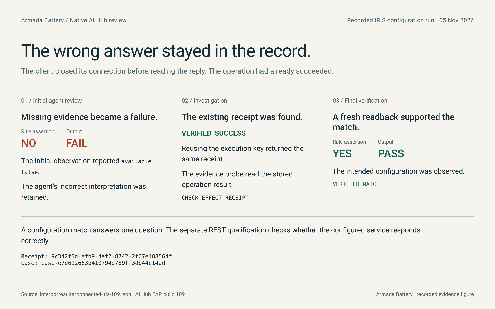
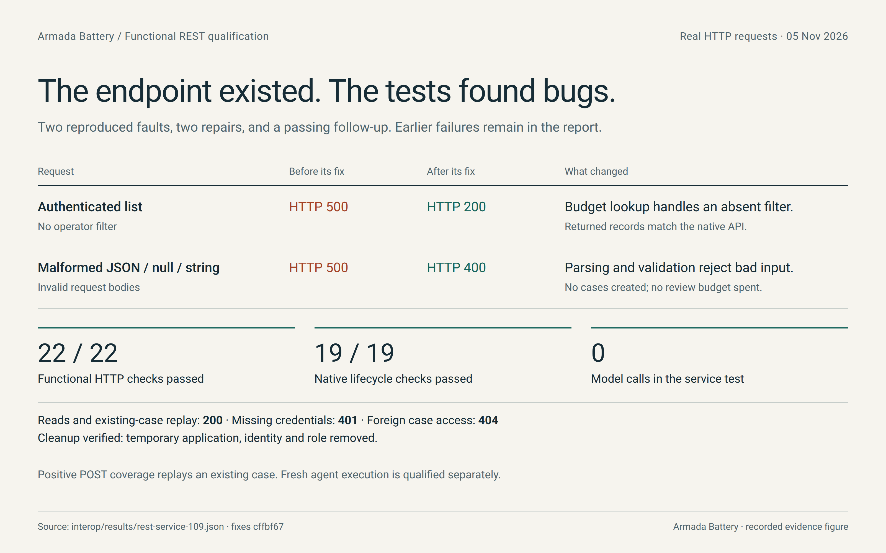
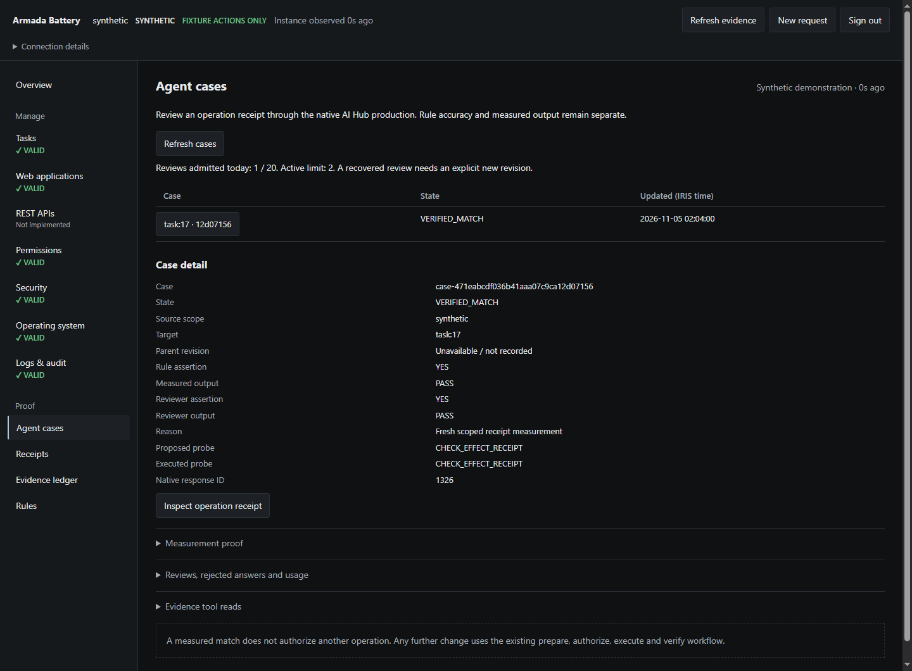
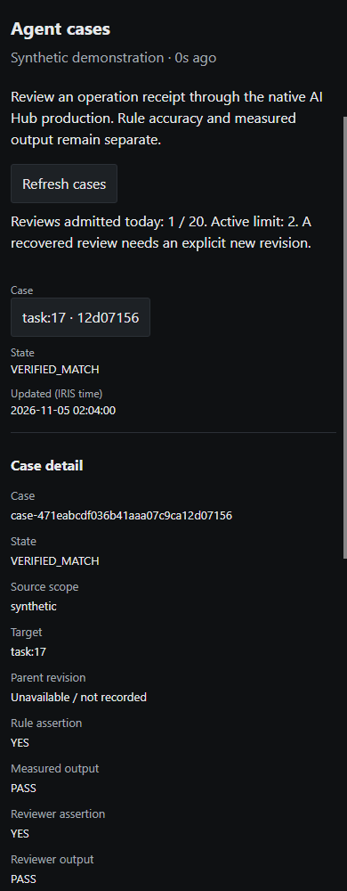

# An AI agent can be wrong and still be useful

The reply was lost. The change was not. I think I've done this before.

A management request can reach InterSystems IRIS, change a configuration, and lose its reply on the way back. The operator sees an error. The change already happened. If the software treats silence as failure and sends the request again, automation has created the next incident.

This began with [The request timed out. Did IRIS change?](https://community.intersystems.com/post/request-timed-out-did-iris-change). The first job was to keep uncertainty visible and stop a lost reply from becoming a duplicate action. Now we are asking agents to help investigate that uncertainty, while keeping the same demand for evidence.

In [Let creativity lead. Make execution answerable.](https://community.intersystems.com/post/let-creativity-lead-make-execution-answerable), I wrote about giving people and agents room to invent while making the resulting work answer to evidence. At that stage, Battery had a synthetic demonstration and a tested live, read-only connection. The next step was to make a real configuration change, review it through native AI Hub, and find out where our confidence outran the implementation.

This is that next step. The agent got something wrong. So did our code. We kept going.

That is the problem I wanted Armada Battery to confront. I intend to succeed by making the machine answer for what it did. Not a special design problem, surely, but rarely is this a glamorous achievement.

## The change that outlived its reply

Our connected test used a disposable installation of IRIS AI Hub EAP build 109. Battery created a temporary REST application configuration, and the client closed the execution connection before reading the response.

We then recovered the successful receipt. Reusing the execution key returned the same receipt, and an independent read found the intended configuration.

When native AI Hub reviewed the result, its first interpretation treated missing evidence as failure. Further investigation found the existing successful receipt, and the final configuration check supported `VERIFIED_MATCH`. The temporary application and test identity were removed afterward.

The model's initial mistake remained in the record. A final green result should not erase the reasoning that needed correction. A fluent explanation is cheap. A correlated receipt and a fresh readback cost effort, but they let us say what happened.

Recorded real IRIS configuration run: the first review was wrong. The receipt and fresh readback supported the final match.

## Two questions hiding inside one green checkmark

That investigation brings us back to the design question. Battery began as a change-control console for IRIS administration. Adding native AI Hub review made an existing question more explicit: what exactly are we asking the agent to judge?

We separate two things:

- **Was the selected rule's assertion supported by the evidence?**
- **Did the observed result satisfy the acceptance criterion?**

Those answers can disagree. A rule can correctly predict an unacceptable result. A result can be acceptable even though the rule used to predict it was wrong or out of context. Finding that disagreement tells us which part of the account needs another look.

Now we are getting into the vagaries of real human judgment. Was the rule wrong, was it applied in the wrong place, or did the work actually fail? Giving those questions their own place in the procedure helps us narrow the investigation. It takes workload from one place and redirects our time to something more productive.

I am not interested in surrendering the whole process to an agent, nor tacking the agentic on because that's the new trend and the market signal. We are giving it a job: review the evidence, identify the disagreement, and help investigate it. A tool and assisting actor inside a solid house with an excellent foundation, the InterSystems platform.

There is also the case where we simply cannot tell. True ambiguity—the worst of all problems when someone expects you to press a button and get on with it. Missing evidence is a reason to investigate or hold, never a license to invent success.

For someone operating a system, this distinction matters more than a polished explanation. They need to know whether the work succeeded, whether their decision rule still makes sense, and what they should inspect next.

## The configuration existed. The service still had bugs.

That demonstration established a configuration change and its readback. There was still an obvious question: does the configured REST service actually work?

So we tested it.

The first authenticated list request returned HTTP 500. The configuration was there, exactly as requested, and the service still failed at an ordinary job.

An empty optional filter broke the budget lookup. We fixed it. Further checks found that malformed JSON and some non-object inputs also returned HTTP 500, where they should have been rejected as bad input. We fixed that too.

We could have left a careful sentence saying that service behavior remained unverified. The sentence would have been accurate. The bugs would also have remained. I would rather have the test and the repair.

After both fixes, **22 functional HTTP checks and 19 native lifecycle checks passed**. Authenticated reads returned the expected records. Access checks withheld other operators' cases. Invalid input was rejected without creating cases or spending review budget. Replaying a valid existing case returned that case unchanged.

The temporary application and test identity were removed afterward. No model calls were needed for this service test; fresh agent execution has its own recorded evidence. Both fixes are installed and published on `contest-49-wip`, with the failed runs kept beside the passing results.

That is the claim we can make: these requests worked after we repaired the failures they exposed. The test procedure and its limits are there for someone else to inspect and repeat.

[Functional REST results, fixes, and reproduction procedure](https://github.com/rbnbric/armada-battery/blob/cffbf67f89c123ad89b9cbb3e488e414e5635e21/docs/REST_SERVICE_EVIDENCE.md)

Measured REST results: two reproduced faults repaired; 22 HTTP checks and 19 native lifecycle checks passed. No model calls in this test.

## The tests that did not all pass

An earlier fixed repeatability run reached the expected disposition in **230 of 240 cases**. Ten cases ended in unexpected review holds. There were no incorrect verified dispositions in that particular corpus.

That is a useful containment result. It also leaves ten cases where the workflow did not complete as intended. Both facts belong in the account.

A later, narrower repeat over eight synthetic receipt scenarios produced **24 expected dispositions in 24 real-model cases**. We kept the earlier result. These runs use different scopes and cannot be combined into one flattering accuracy number. The later result is evidence of progress on that profile, with more work needed on unfamiliar cases.

The REST checks measure service behavior; those repeatability runs measure review outcomes. A working endpoint does not make the model more accurate. Each test has to answer its own question.

[Earlier repeat](https://github.com/rbnbric/armada-battery/blob/f3f438a177b27f834aa022ebb7fc810acd8a4b15/interop/results/solver-repeat-109.json) · [Later qualification and connected demonstration](https://github.com/rbnbric/armada-battery/blob/f3f438a177b27f834aa022ebb7fc810acd8a4b15/docs/IMPLEMENTATION_EVIDENCE.md)

## The ordinary engineering is part of the experience

The earlier post described a tester finding a broken installation path and the repair that followed. This round brought us back to that same obligation: what happens when somebody actually tries to use the thing?

Some of the work was much less dramatic: checking the actual endpoint's fields, fixing session cleanup, making interrupted reviews visible, and checking the phone layout. The awkward integration work is the product work.

After the REST fixes, the application checks still passed **86 Python tests and 13 UI tests**. Those checks accompany the native integration evidence; they do not substitute for it.

A person does not experience those pieces separately. They experience whether the interface tells them what happened, preserves their place, and gives them a useful next step. An excellent explanation loses much of its value if the surrounding application leaves stale information on screen.

Our company's bespoke internal tools are built around these same design principles and engineering practices. They help us develop, test, and refine the work consistently, and contribute substantially to its quality.

Actual installed application: a real native AI Hub review of a synthetic management operation. This is a separate case from the IRIS configuration study.

The same installed case at a 390px phone viewport. Rule assertion and measured output remain separate fields.

## What I mean by augmentation

This is still the creative ambition I started with. Each repair gives us firmer ground to build on.

I want and work to create software that takes more of the investigative burden off the person using it. Inform the user, let them decide. Give them tools, not something to babysit, nor a full replacement onto which we dump all the blame. Soon, nobody can account for the result. Just another unset VCR clock, another piece of tech to kick hoping it works better, another... burdensome issue. Kick the can. One day somebody will fix it.

[“PLEASE SET CLOCK”](https://www.flickr.com/photos/62439250@N00/361316740) by [jon satrom](https://www.flickr.com/people/jonsatrom/), licensed [CC BY-NC-SA 2.0](https://creativecommons.org/licenses/by-nc-sa/2.0/). Photograph unchanged.

Something that helps them ask a better question, find the relevant observation, and understand why a result is still uncertain: that's the real future. Augment, don't replace or lose, and make human and agent better together. A cybernetic vision where harmony reigns, where capacities grow, and where something better comes out of the sum of the parts rather than a yoke dragging us back down.

The agent is allowed to be wrong and so are you, but hopefully, together, you never have to stay wrong. The procedure to become right is laid out and ready. Now seize it. As your partner, it must report truthfully: what it observed, what it inferred, what it does not know, and what observation would settle the question. A guess presented as an observed fact destroys that value.

My standard for total augmentation is simple: the conventional system must make the facts, permissions, and possible actions understandable before an agent is allowed to improvise. Its reasoning should help the operator move forward—make progress to completing real tasks—even when its first answer fails. A person should be able to recover from an uncertain result without learning the internals of every service. Try, try, and try again. We will succeed, together.

Battery is a narrow experiment in that direction. We still need broader real adapter coverage, unfamiliar test cases, and a comparison against the same workflow without agent investigation. The comparison will help establish where the extra reasoning earns its time and cost. In all honesty, it really needs to look prettier and have a better user experience, but I hope you enjoy the tools doing what they're intended for in the meantime.

## Try it and give us a difficult case

The [browser walkthrough](https://rbnbric.github.io/armada-battery/) is an earlier, credential-free synthetic management demonstration. It sends no IRIS requests and does not run the native AI Hub agents.

For the new workflow, use the current [contest-49-wip source and native setup](https://github.com/rbnbric/armada-battery/blob/contest-49-wip/docs/NATIVE_CASE_WORKFLOW.md), including the REST fixes described here. It requires the separately obtained AI Hub EAP image and configured model access. InterSystems provides the [EAP documentation and download instructions](https://github.com/intersystems-community/ai-hub-eap).

What is the awkward case in your interoperability work: a late reply, stale configuration, conflicting evidence, or a rule that makes sense until its context changes? A small, sanitized example and the result you would expect would give us something concrete to test. Bring us the point where the tool stops helping. That is where the next repair should start.

Limit personality. Maximize accessibility. Minimize hurdles. Build the scaffold. Test the cases that make a confident demo uncomfortable. Then let the machine take on more work as it earns that responsibility.

Let creativity lead. Make execution answerable. Then come back with the repairs.
